# ONE ROUTER

A self-hosted AI chat workspace and OpenAI-compatible API gateway. Connect your own OpenAI, Anthropic, Gemini, Ollama, or compatible providers and switch models in the same conversation.

## Run it

With Node.js 24 or newer, run `npx onerouter` once the first npm release is published. Until then, use the [Docker guide](./apps/site/content/docs/docker.mdx) or [build from source](./apps/site/content/docs/installation.mdx#build-from-source).

- Search and pin chats, attach files, or start a temporary chat.
- Connect OpenAI-compatible tools through your own gateway and model aliases.
- Keep data on your infrastructure and move it with an encrypted archive.

[Documentation source](./apps/site/content/docs) · [Run `/docs` locally](./apps/site/content/docs/development.mdx#run-the-docs-locally) · [MIT License](./LICENSE)
